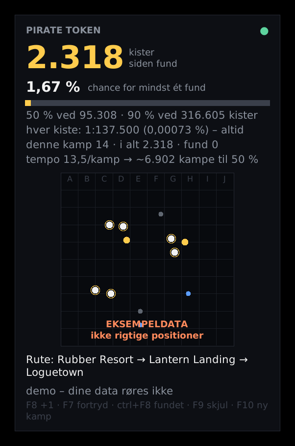

# Pirate Token HUD

En lille click-through-tæller oven på Fortnite: hvor mange kister du har åbnet siden
sidste fund, hvad det svarer til i chance, og hvor langt der realistisk er igen.



**Kræver kun Python 3.10+ til Windows.** Ingen `pip install`, intet `keyboard`-modul.

## Kom i gang (5 minutter)

**Nemmest: pak zip-filen ud og dobbeltklik `installer.bat`.** Den installerer Python, sætter Fortnite
til Windowed Fullscreen og laver en genvej. Trin-for-trin og fejlfinding: [GUIDE.md](GUIDE.md).

Manuelt:

1. Installér Python fra python.org, og sæt flueben i **"Add to PATH"**.
2. Sæt Fortnite til **Vinduesbaseret fuldskærm** (Indstillinger → Video → Vinduestilstand).
   I almindelig fuldskærm kan *intet* overlay vises oven på spillet.
3. Dobbeltklik **`demo.bat`** for at se HUD'en med eksempeltal (dine data røres ikke).
4. Dobbeltklik **`start.bat`**, og spil.

## Taster

| Tast | Gør |
|---|---|
| **F8** | +1 kiste (tryk lige når kisten åbner) |
| **F7** | fortryd sidste tryk (også et fejl-"fundet") |
| **Ctrl+F8** | **fundet!** nulstiller "siden fund", gemmer i `data/fund.csv` |
| **F9** | skjul/vis |
| **Ctrl+F9** | flyt HUD'en (øverst/midt/nederst, venstre/højre) |
| **F10** | ny kamp (kun hvis loggen ikke selv fanger kampstart) |

Tasterne kan ændres i `config.json`. Står der "⚠ F8 er optaget af et andet program", så
vælg en anden tast. Tasterne registreres hos Windows, så Fortnite får dem **ikke**
(ingen dobbelt-handling i spillet).

## Hvad HUD'en viser

- **Kister siden fund** – gemmes efter hvert tryk i `data/state.json`. Tallet overlever
  genstart af HUD'en, pc'en og Fortnite.
- **Chance for mindst ét fund** i så mange kister.
- **50 % ved 95.308 · 90 % ved 316.605 kister** og en bjælke der viser hvor langt du er mod 50 %.
- **Tempo** (kister pr. kamp) og **cirka hvor mange kampe der er igen** til 50 %.
- Kamp-ur, rute og (valgfrit) kort.

### Ærlig matematik

Hver kiste har den **samme** chance (1:137.500 med standardindstillingen), uanset hvor
mange du har åbnet. Du kan ikke være "tæt på" eller "have den til gode". Tallet der
vokser er chancen for at du *allerede* ville have fundet den. Med ~13 kister pr. kamp er
50 %-punktet omkring **7.300 kampe** væk. Det er derfor HUD'en viser det.

Tallet 1:137.500 kommer fra din gamle config og er **ikke verificeret**. Ret
`odds_per_chest` hvis du finder en bedre kilde. Brug `boost` (fx `2.0`) under events.

## Første gang: få kampstart/kampslut til at virke

Mønstrene i `config.json` er kvalificerede gæt. Sådan ser du, om de rammer:

1. Spil mindst én kamp færdig med Fortnite (HUD'en behøver ikke køre).
2. Dobbeltklik **`tjek-log.bat`**. Den kører mønstrene over **alle** dine gemte
   Fortnite-logs (også de gamle) og skriver fx:
   ```
   MATCH_START    3  OK
   MATCH_END      0  RAMMER IKKE – ret mønstret
   ```
   Under det står de linjer fra loggen der ligner kampstart/kort/kister, så du kan
   bygge et nyt mønster. Hele rapporten ligger i `kalibrering/tjek.txt`.
3. Ret `patterns` i `config.json`. Du behøver ikke genstarte: HUD'en indlæser
   filen igen efter ~2 sekunder. Husk at en backslash skrives `\\` i JSON.

Virker det slet ikke, så brug **F10** ved hver ny kamp. Alt andet virker stadig.

## Kan kisterne tælles automatisk?

Måske, men det ved ingen før det er målt. Fortnite skriver muligvis slet ikke noget i
loggen når du åbner en kiste. Derfor er `CHEST` tom fra start, og F8 er tælleren.

HUD'en måler det selv, mens du spiller: hver gang du trykker F8, gemmer den
loglinjerne fra lige før og efter (`kalibrering/tryk.jsonl`). Efter 10-30 tryk:

1. Dobbeltklik **`analyser-kister.bat`**.
2. Den finder linjer der optræder ved næsten hvert tryk, men sjældent ellers.
   - **God kandidat:** den skriver en færdig linje du kan sætte ind i `config.json`:
     `"CHEST": ["…"]`. Derefter tæller HUD'en selv. Stop så med F8 for kister.
   - **Ingen kandidat:** så logger Fortnite ikke kister. Bliv ved med F8, det er fint.

Slå optagelsen fra med `"capture_chest_windows": false`.

## Kortet

`spawns.json` er stadig **eksempeldata** fra den gamle pakke, og HUD'en skriver det
på kortet. Du kan:
- sætte `"show_map": false`, eller
- lave rigtige data med `convert_dump.py` (se toppen af filen). Brug `--bounds` med
  kortets yderkanter, ellers bliver det strakt. Unreal-koordinater er ofte drejet,
  så prøv `--swap-xy`/`--flip-y` og tjek mod et kendt sted, eller
- lægge et PNG af kortet i mappen og sætte `"map_image": "kort.png"`.

Ruter fremhæves med hvid prik og guld ring. Guld prik = rare, blå = buried.

## Filer

| Fil | Indhold |
|---|---|
| `data/state.json` | din tæller (slet den for at starte forfra) |
| `data/historik.csv` | én linje pr. kamp: start, slut, sekunder, kister (åbner i dansk Excel) |
| `data/fund.csv` | dine fund |
| `kalibrering/` | optagelser til `analyser-kister.bat` og `tjek-log.bat` |

## Hvad HUD'en rører (og ikke rører)

- **Læser** `%LOCALAPPDATA%\FortniteGame\Saved\Logs\FortniteGame.log`, en tekstfil spillet selv
  skriver. Filen holdes ikke åben, så Fortnite kan stadig rotere den.
- Ingen hukommelseslæsning, ingen injektion, intet håndtag til spillets proces. "Har Fortnite
  fokus?" afgøres ud fra forgrundsvinduets titel/klasse.
- Ingen tastatur-hook: kun de taster du har valgt, registreret hos Windows.
- Overlayet er click-through og tager aldrig fokus.

Det er samme slags ting som Discord- og Steam-overlays gør, men **der er ingen garanti**:
Epic bestemmer selv, hvad de accepterer af tredjepartsprogrammer.

## Fejlfinding

| Problem | Løsning |
|---|---|
| HUD'en ses ikke i spillet | Vinduesbaseret fuldskærm. Prøv F9. Se om `hide_when_not_fortnite` skjuler den |
| "venter på Fortnite-loggen" | Start spillet. Ligger loggen et andet sted, så sæt `log_file` i config |
| Prikken er grå | loggen findes, men der er ikke kommet nye linjer i 30 sek (normalt i menuer) |
| "⚠ … optaget af et andet program" | vælg en anden tast i `config.json` og genstart |
| Uskarp/forkert størrelse | `"scale": 1.25` osv. |
| Tallet blev nulstillet | `data/` er blevet slettet eller flyttet; mappen skal ligge ved `hud.py` |

## Til udviklere

```
py -m unittest discover -s tests -t .
```
Logik, log-læsning, kalibrering og konvertering testes på alle systemer. UI-testen kører
den rigtige HUD mod en falsk log (kræver skærm, på Linux: `xvfb-run`).
Windows-delene (`winapi.py`) er skrevet mod dokumenterede Win32-kald, men kan kun
afprøves på Windows.
